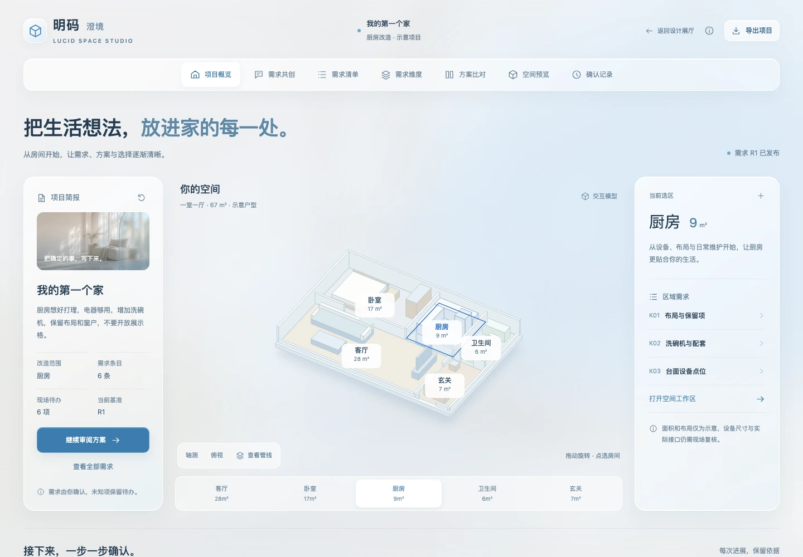
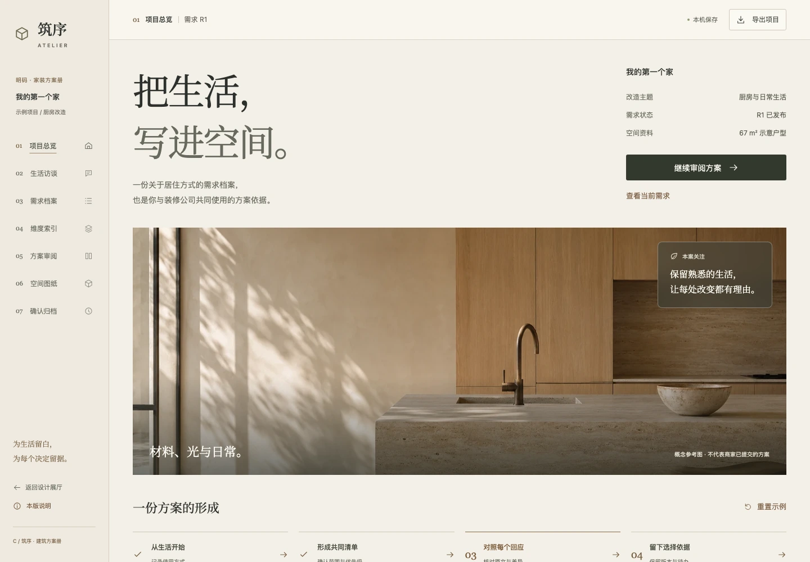
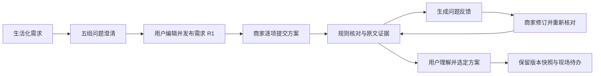

# 明码 · 家装需求与方案协作

把生活化的装修想法变成双方确认的需求，再逐条看清商家方案如何回应。

明码是面向「艾可思 · AI 家装服务平台」赛题的前端 MVP。目前以**厨房硬装改造**为可操作示例，完成需求澄清、方案核对、商家修订与用户确认的闭环。当前助手由本地问题模板和明确规则驱动，尚未接入大模型或后端服务。

**推荐入口：[`mingma-lab`](mingma-lab/README.md)** · [演示步骤](docs/demo-guide.md) · [产品需求文档](docs/明码产品需求文档_v1.0.pdf) · [实现结构](docs/architecture.md) · [协作指南](CONTRIBUTING.md)

## 三种完整界面

三版都有 8 个功能页面和相同的业务规则，页面组织与视觉表达各不相同。每版的项目、商家草稿和量表数据独立保存，可以并排体验。

| 雾屿 Atmosphere | 澄境 Lucid | 筑序 Atelier |
| --- | --- | --- |
|  |  |  |
| 自然摄影、烟色磨砂玻璃、生活便签与悬浮导航 | 浅色光学玻璃、中央空间画布、区域需求抽屉 | 建筑方案册、纸面档案、章节导航与证据批注 |
| [版本说明](mingma-lab/versions/atmosphere/README.md) · [手机首屏](mingma-lab/public/previews/atmosphere-mobile.webp) | [版本说明](mingma-lab/versions/lucid/README.md) · [手机首屏](mingma-lab/public/previews/lucid-mobile.webp) | [版本说明](mingma-lab/versions/atelier/README.md) · [手机首屏](mingma-lab/public/previews/atelier-mobile.webp) |

## 体验流程



用户可以表达「好打理、想加洗碗机、不要开放展示格」，再逐步确认布局、设备、清洁、柜体与门窗范围。系统按需求编号展示两家模拟商家的回应，指出缺失说明和明确冲突，并保留可查看的方案原文。用户修改需求后必须重新发布版本，旧方案和历史选择仍绑定原基准。

| 页面 | 当前可操作内容 |
| --- | --- |
| 项目概览 | 新项目入口、完整演示、房间选择、进度提示 |
| 需求共创 | 生活化表达、五组选择题、草稿恢复与未知项 |
| 需求清单 | 编辑、优先级、自定义需求、发布与历史版本 |
| 维度量表 | 10 项业主维度 + 9 项商家维度，成熟度、依据与导出 |
| 方案比对 | 两商家逐项对照、原文证据、待处理筛选、问题反馈 |
| 商家工作区 | 表单或 CSV 提交、草稿保存、修订与重新核对 |
| 空间预览 | 房间联动、旋转缩放、轴测/俯视、墙体和水电图层 |
| 确认记录 | 方案选择、需求与方案快照、现场待办、项目导出 |

## 在本机运行

需要 **Node.js 24** 和随附的 npm。根目录 `.nvmrc` 与持续集成使用同一 Node 主版本。项目不需要 API Key、数据库或环境变量。

```sh
git clone https://github.com/feifeifei686/bohack-project.git
cd bohack-project/mingma-lab
npm ci
npm run dev
```

仓库为私有仓库，克隆需使用有访问权限的 GitHub 账户。使用 nvm 的开发者可在仓库根目录先运行 `nvm install` 和 `nvm use`。

启动后打开 **[本地设计展厅](http://127.0.0.1:5188/)**。开发服务仅绑定本机；停止服务按 `Ctrl+C`。三个版本从展厅进入，不要分别在版本子目录安装或启动。

```sh
# 在 mingma-lab 目录运行
npm test
npm run build
npm run preview -- --port 5190
```

`npm test` 执行三版领域规则测试；`npm run build` 先检查三版 TypeScript，再生成统一静态站点到 `mingma-lab/dist/`。生产预览地址为 [http://127.0.0.1:5190/](http://127.0.0.1:5190/)。页面需要通过 HTTP 服务打开，不要直接双击 HTML 文件。

## 获取体验包

仓库的 [GitHub Actions](https://github.com/feifeifei686/bohack-project/actions) 自动安装依赖、执行领域测试、检查并构建三个工程；成功运行后，在该次运行的 **Artifacts** 中下载 `mingma-preview-<提交哈希>`。下载需要仓库访问权限。

产物包含已构建体验包、设计展厅源码包和校验清单。体验包解压后，按包内 README 使用 Python 3 启动即可，无需 npm。产物保留 14 天；如已过期，可重新运行工作流或从源码构建。仓库当前不提供公开在线演示站点。

## 项目结构

```text
mingma-lab/     当前推荐：统一展厅 + 三套完整前端
mingma-mvp/     早期单版 MVP，保留产品迭代过程
mingma-3d/      早期 Three.js 户型与线路实验
docs/          产品需求文档、架构说明、演示路径
diagrams/      需求思维导图与决策闭环，可编辑源文件
.github/       自动检查、Issue 与 Pull Request 模板
```

三个工程各自管理依赖与锁文件。`mingma-3d` 是 WebGL 实验，并非当前主入口；`mingma-lab` 中的户型使用三维顶点投影的 SVG，交互不依赖 WebGL。完整目录和关键源文件见[架构说明](docs/architecture.md)。

## 验证与边界

已有验收记录包含三版共 **42 项领域测试**，每版 14 项主流程、10 项空间交互和 15 项边界浏览器断言，以及展厅检查、390px 手机布局检查和解压静态包验证。历史验收摘要在 [`verification.json`](mingma-lab/review/verification.json)；当前提交是否通过自动检查，以其 Actions 结果为准。浏览器脚本需单独运行，不包含在 `npm test` 中。

- 目前只使用本机浏览器 `localStorage`，没有商家身份认证、云端保存、跨设备同步或真实消息发送。
- 当前核对判断表示**文字回应是否覆盖规则要点**，不能证明施工可行性。编辑后或自定义需求会保留人工核对状态。
- 商家方案通过表单和结构化 CSV 提交，尚未实现任意 PDF、扫描件或 CAD 的识别。
- 户型、面积、水电线路和商家名称用于演示；空间图不是施工图。真实尺寸和专业条件需单独确认。
- 量表 0–3 表示信息成熟度，优先级单独记录；有依据才可确认到 3 级。
- 当前产品范围不包含报价、价格比较、交易付款。自动学习与「日新」规则迭代仍是后续规划。

## 继续开发

先阅读[产品文档索引](docs/README.md)和[协作指南](CONTRIBUTING.md)。后续优先选定一套主界面、提取三版重复的领域代码，再在保留版本和证据规则的前提下设计真实服务集成。

素材与字体的来源、许可及当前项目授权状态见 [THIRD_PARTY_NOTICES.md](THIRD_PARTY_NOTICES.md)。
