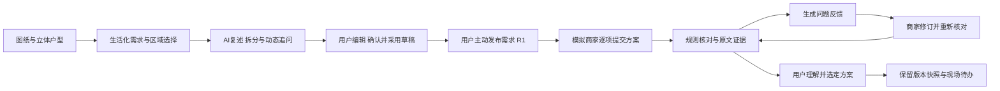

# 安居有数

**Dream Defined. Living Refined.**

安居有数是「艾可思 · AI 家装服务平台」赛题的硬装协作 MVP。业主从户型和生活需求出发，通过 AI 多轮追问形成可核对的需求清单，再逐项查看装修方案如何回应。

- **从户型开始** · 用演示图纸或上传 JPG、PNG、WebP，AI 识别房间、门窗和图中家具，支持手工校对。看平面图成形为立体沙盘，点选房间进入区域规划。
- **和 AI 梳理需求** · DeepSeek 根据表达和项目背景追问，整理全屋、分区和公共项。沙盘缩入右上角，随问题高亮对应空间。整理成功后自动定位到新追问或草稿。
- **对照方案并确认** · 业主确认并发布清单，模拟商家逐项回应。页面根据原文标出覆盖、遗漏和冲突，支持反馈、修订及版本回看。

当前部署直达「澄境」。项目与 AI 结果只保留在本轮，刷新后清空，演示结束前可导出项目。商家回应采用模拟数据和本地规则。

[运行指南](docs/local-deployment.md) · [演示步骤](docs/demo-guide.md) · [产品需求文档](docs/明码产品需求文档_v1.0.pdf) · [架构](docs/architecture.md) · [协作指南](CONTRIBUTING.md)

## 体验流程



用户可以表达「厨房好打理、想加洗碗机、客厅到走道地面连贯」，并选择多个区域。AI 每批提出最多两道相关问题，支持单选、多选、自由补充和暂缓；未知尺寸保留为空，专业条件保留核实责任人。建议项需要主动采纳，拟纳入条目需要逐项确认，采用后仍由用户在“我的需求”发布版本。已有快照不会被新一轮对话覆盖。

| 页面 | 当前可操作内容 |
| --- | --- |
| 项目概览 | 约 7 秒的三维住宅搭建、建筑结构切换、连续进入规划、完整演示 |
| 空间选择 | 上传图片自动识别房间、门窗和家具，手工校对、立体户型及需求联动 |
| 需求共创 | 真实 AI 拆分与追问、分步问卷、逐题补充、建议采纳、逐条确认与导出 |
| 我的需求 | 当前清单、派生待确认、项目背景、发布与本轮历史版本 |
| 风险评估 | 需求或方案八维检查、原文依据、核实安排、复评与版本快照 |
| 方案比对 | 两商家逐项对照、原文证据、待处理筛选、问题反馈 |
| 商家工作区 | 承接与协作引导、表单或 CSV 提交、草稿保存、修订与重新核对 |
| 空间预览 | 默认六层工程分解，合拢、展开、选择、单层查看与旋转缩放；可切回房间与线路 |
| 确认记录 | 方案选择、需求与方案快照、现场待办、项目导出 |

## 一个需求入口

“我的需求”以清单为主体，待确认信息直接从当前需求派生，点击即可定位原条目。范围、重要程度、标准与待办不再去另一张量表重复填写；旧 `#dimensions` 链接会进入 `#requirements`。

项目背景只维护三项：使用者与生活习惯、居住安排与时间、交付与确认方式。保存后随下一次 AI 梳理传入；共创中只读展示，修改回到“我的需求”。背景变化会撤销相关旧确认并提示重新整理，发布版本同时保存当时的背景快照。

商家的九个维度作为商家工作区的承接与协作引导。

## 在本机运行

macOS 已配置本机部署时，可以双击根目录的 [启动明码.command](启动明码.command)，浏览器入口仍是 `http://127.0.0.1:5188/`。关闭终端不会停止服务；重启电脑或退出登录后再双击启动。停止、更新和日志位置见[本机部署说明](docs/local-deployment.md)。开发调试前先停止部署服务，释放 5188 和 5199 端口。

需要 **Node.js 24** 和随附的 npm。根目录 `.nvmrc` 与持续集成使用同一 Node 主版本。浏览页面和完整演示案例无需模型密钥；真实需求共创需要已配置的 AI 服务，见下文。

```sh
git clone https://github.com/feifeifei686/bohack-project.git
cd bohack-project/mingma-lab
npm ci
npm run dev
```

仓库为私有仓库，克隆需使用有访问权限的 GitHub 账户。使用 nvm 的开发者可在仓库根目录先运行 `nvm install` 和 `nvm use`。

启动后打开 **[澄境演示首页](http://127.0.0.1:5188/)**。开发服务仅绑定本机；停止服务按 `Ctrl+C`。部署入口采用澄境。演示数据只保留在当前页面内，刷新或重新打开后清空。

```sh
# 在 mingma-lab 目录运行
npm test
npm run build
npm run preview -- --port 5190
```

`npm test` 执行三版领域规则及共享访谈状态测试；`npm run build` 先检查 TypeScript，再生成统一静态站点到 `mingma-lab/dist/`。开发服务会将 `/api` 代理到本机 5199，需另行启动 `mingma-api`；独立静态预览仍需要同源 API 网关才能使用 AI。页面需要通过 HTTP 服务打开，不要直接双击 HTML 文件。

## 获取体验包

仓库的 [GitHub Actions](https://github.com/feifeifei686/bohack-project/actions) 配置会检查前端工程和 AI 服务，运行本地自动测试及构建；不会使用真实模型密钥。成功运行后，在该次运行的 **Artifacts** 中下载 `mingma-preview-<提交哈希>`。下载需要仓库访问权限。

产物包含已构建体验包、前端源码包和校验清单。静态体验包可按包内 README 使用 Python 3 启动浏览，无需 npm；它不包含模型密钥或 API 服务，AI 共创需另行提供同源 `/api`。服务不可用时会保留输入并提示错误，不静默返回演示答案。产物保留 14 天；如已过期，可重新运行工作流或从源码构建。仓库当前不提供公开在线演示站点。

## 项目结构

```text
mingma-lab/     当前入口：澄境 MVP，保留历史设计源码
mingma-mvp/     早期单版 MVP，保留产品迭代过程
mingma-3d/      早期 Three.js 户型与线路实验
mingma-api/     DeepSeek 接口、契约、类型客户端与测试
postman/        可运行请求集合与 DeepSeek 本地依赖模拟
scripts/        macOS 本机服务管理、静态网关与网关测试
docs/          产品需求文档、架构说明、演示路径
diagrams/      需求思维导图与决策闭环，可编辑源文件
.github/       自动检查、Issue 与 Pull Request 模板
```

各工程独立管理依赖与锁文件。`mingma-3d` 是早期 WebGL 实验，并非当前主入口。澄境首页与六层工程预览使用 Three.js；原“房间与线路”模式仍使用 SVG 投影。WebGL 不可用时，首页显示参考图并保留规划入口，工程页保留分层说明和旧模式入口。完整目录和关键源文件见[架构说明](docs/architecture.md)。

## AI 接口

在 `mingma-api` 中执行 `npm ci`，按[服务说明](mingma-api/README.md)配置本地 `.env` 后运行 `npm run build`、`npm start`，默认服务地址为 `http://127.0.0.1:5199`。模型 Key 只在服务端使用，不进入前端或仓库。

户型识别调用 `POST /api/ai/floorplan`，复用服务端 DeepSeek Flash 视觉能力；图纸在浏览器压缩后发送，服务端不存图、不记录图像正文。返回候选轮廓、墙线、开口和可见家具，前端保留原有搭建、抬升和问卷转场动画。空结构图不自动补家具。

新需求共创调用 `POST /api/ai/intake`，统一完成拆分、追问和草稿整理。原 `clarify`、`requirements`、`review`、`explain` 四个接口保留。结果带来源引用、未知项和人工确认标记；接口无状态，不自动发布、修改商家承诺或选定方案。

开启 LAN 后，同一局域网中的设备可直接使用 AI 需求共创，无需输入访问码。网关向局域网开放 `POST /api/ai/intake` 和 `POST /api/ai/floorplan`，其他 AI 接口仍限本机；DeepSeek 密钥始终保存在服务端。详情见[本机部署说明](docs/local-deployment.md)。

[接口字段与错误说明](docs/api/README.md) · [OpenAPI](docs/api/openapi.json) · [调用示例](mingma-api/examples/) · [验证记录](docs/api/verification.json)

## 验证与边界

户型识别、分步问卷与风险评估分别见[户型验证](docs/floorplan-recognition-verification.json)、[问卷验证](docs/questionnaire-workflow-verification.json)和[风险评估验证](docs/risk-assessment-verification.json)。这些记录区分真实模型调用、本地依赖模拟与浏览器检查；候选识别数量不代表整体准确率。

此前首页与工程预览的结果见[空间交互验证记录](docs/ui-transition-verification.json)：73 项前端、52 项 API、6 项网关与生命周期测试通过，TypeScript、构建和 ZIP 打包通过。浏览器已检查桌面/手机、工程层操作、键盘再次进入规划及 WebGL 降级；减少动态效果仅完成源码核查，未做浏览器模拟。当前提交是否通过云端检查，以其 Actions 结果为准。

上一轮“我的需求”整合的页面、迁移、接口与部署结果见[整合验证记录](docs/requirements-unification-verification.json)，覆盖旧记录保留、背景的唯一来源、确认失效、旧路由兼容和发布快照。

上一轮需求获取的 56 项前端测试、48 项 API 测试、39 个依赖模拟场景及 21 个 Postman 断言保留在[当时的验证记录](docs/intake-release-verification.json)，不代替本轮验收。

旧版每版 14 项主流程、10 项空间及 15 项边界浏览器断言，以及旧静态包和视觉验收保留在[带日期的历史摘要](mingma-lab/review/verification.json)。这些记录不代替新需求页面的验收；浏览器脚本也不包含在 `npm test` 中。

- 澄境项目、访谈和上传图纸只保留在本轮页面内存，刷新后清空；没有商家身份认证、云端保存、跨设备同步或真实消息发送。
- 当前核对判断表示**文字回应是否覆盖规则要点**，不能证明施工可行性。编辑后或自定义需求会保留人工核对状态。
- 商家方案通过表单和结构化 CSV 提交，尚未实现任意 PDF、扫描件或 CAD 的识别。
- 户型、面积、水电线路和商家名称用于演示；工程分层复用首页住宅，未关联上传图纸或商家方案。空间图不是施工图，真实尺寸和专业条件需单独确认。
- 独立维度评分表已撤下；旧分值仅供追溯。项目背景的“已确认”表示用户核对过该信息，不表示施工条件已核实。
- 当前产品范围不包含报价、价格比较、交易付款。自动学习与「日新」规则迭代仍是后续规划。

## 继续开发

先阅读[产品文档索引](docs/README.md)和[协作指南](CONTRIBUTING.md)。需求共创由三版共享模块维护；户型图片上传、AI 房间/门窗/家具识别、概念立体生成、房间与家具位置校对已可用；逐点轮廓编辑、门窗编辑和真实尺寸校准仍待实现。后续可继续接入商家方案语义审查，保留版本、证据和用户确认规则。

素材与字体的来源、许可及当前项目授权状态见 [THIRD_PARTY_NOTICES.md](THIRD_PARTY_NOTICES.md)。

## 风险评估栏目

生成需求后可进入“风险评估”，在当前草稿、已发布需求和各商家方案之间切换。八个维度统一展示，第一版运行安全核验提示、信息缺口、必须项回应与决策冲突检查；预算、预备金、结构化报价及工期依据不足时明确显示待评估，不生成价格判断或 FMEA 分数。

问题可回看原文、进入需求或商家方案修改、记录责任人和资料。填写处理说明不等于完成专业核验。修改源数据后旧结果显示需重新评估，发布需求和选定方案时再次检查，并保存当时的评估快照。所有数据仍仅保留在本轮页面，离开前可导出。详见[评估实现说明](docs/risk-assessment.md)。
