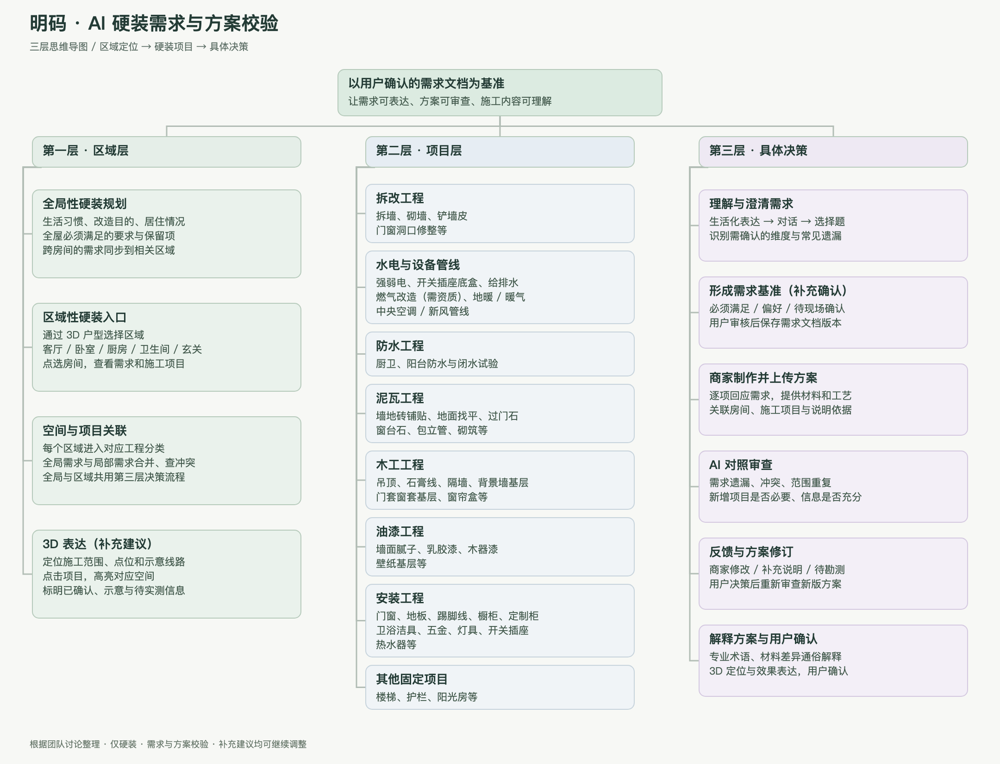
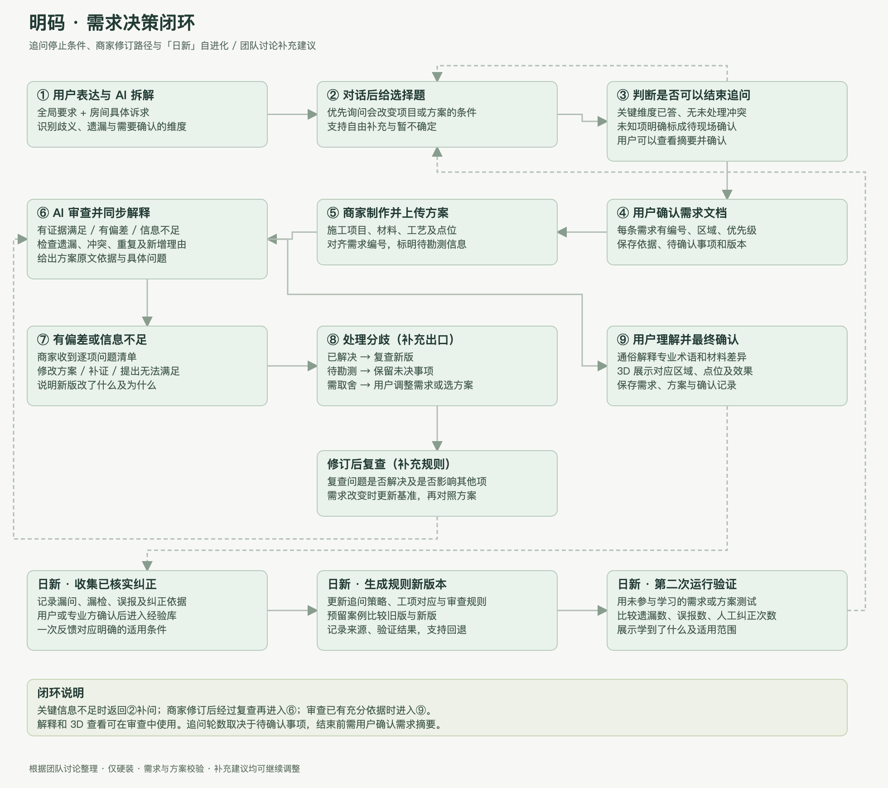

# 明码产品图示

图示用于描述区域、工程项目与需求决策之间的关系。它们呈现完整产品思路，包含未实现的能力；当前 MVP 的实际范围请看[主 README](../README.md)和[实现结构](../docs/architecture.md)。

## 需求结构思维导图

从全局和区域要求进入硬装项目分类，再走向需求澄清、商家回应、证据审查与用户确认。

[SVG 矢量图](mingma-mindmap.svg) · [Mermaid 源文件](mingma-mindmap.mmd) · [Excalidraw 可编辑文件](mingma-mindmap.excalidraw)

## 决策闭环

展示需求确认、方案修订、分歧处理与最终归档的关系。下方「日新」经验记录和规则版本迭代是后续设计，尚未在当前前端中自动执行。

[SVG 矢量图](mingma-decision-loop.svg) · [Mermaid 源文件](mingma-decision-loop.mmd) · [Excalidraw 可编辑文件](mingma-decision-loop.excalidraw)

图中的 AI 审查表示产品目标；当前可运行演示由问题模板和文本规则实现。当前户型和路线仅辅助理解方案，不具备施工图精度。编辑图示后应同时更新预览图片，避免源文件与展示结果不一致。
