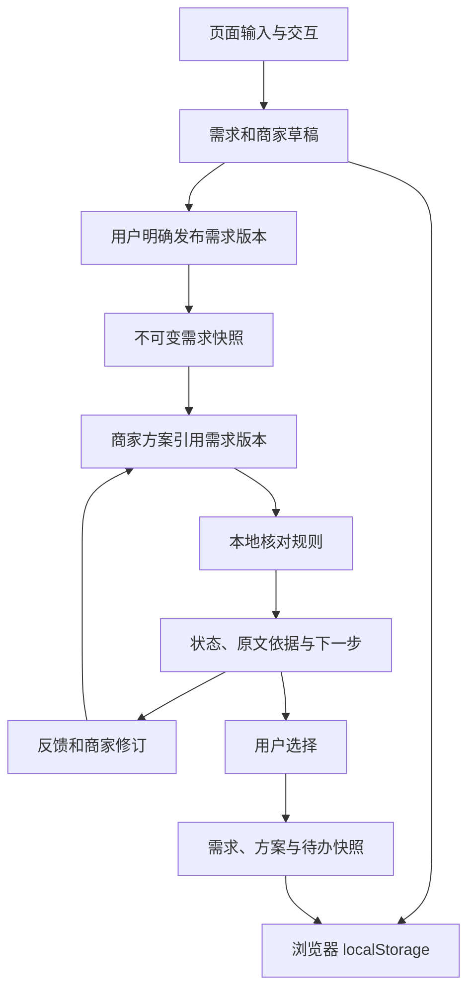

# 当前实现结构

明码当前是浏览器本地运行的静态前端。推荐入口 `mingma-lab` 使用 Vite、TypeScript 与 Tailwind CSS 构建统一展厅和三套界面；没有后端、数据库、实际模型请求或商家通信服务。

## 工程之间的关系

| 工程 | 当前作用 | 安装与启动位置 |
| --- | --- | --- |
| `mingma-lab` | 当前主工程：设计展厅和三套完整流程 | 在该目录执行 `npm ci`、`npm run dev` |
| `mingma-mvp` | 早期单版 MVP，保留迭代历史 | 在该目录安装；开发可使用 `npm run dev -- --port 5180` |
| `mingma-3d` | 早期 Three.js / WebGL 户型线路实验 | 在该目录安装；开发可使用 `npm run dev -- --port 5178` |

三个目录是独立 npm 工程，不是 npm workspace。`mingma-lab/versions/` 下的三版由主工程统一构建，不应各自启动 Vite。

## 主工程文件地图

| 路径（相对 `mingma-lab`） | 职责 |
| --- | --- |
| `index.html`、`gallery.css`、`gallery.js` | 展厅、三版入口、截图和独立验收清单 |
| `vite.config.ts` | Tailwind 插件、相对资源路径、展厅与三个版本的构建入口 |
| `versions/<版本>/src/main.ts` | 页面模板、hash 导航、事件处理、状态与本地存储 |
| `versions/<版本>/src/domain.ts` | 需求生成、方案文本核对、演示修订和 CSV 解析 |
| `versions/<版本>/src/domain.test.ts` | 该版领域规则测试 |
| `versions/<版本>/src/dimensions.ts` | 10 项业主与 9 项商家维度定义 |
| `versions/<版本>/src/house-data.ts` | 房间、尺寸和水电线路的演示数据 |
| `versions/<版本>/src/glass-model.ts` 或 `atelier-model.ts` | 当前使用的交互空间投影绘制 |
| `versions/<版本>/src/style.css` 及其导入样式 | 各版布局、视觉和响应式规则 |
| `public/assets/`、`public/fonts/`、`public/previews/` | 视觉素材、本地字体、实际界面截图 |
| `scripts/check.mjs` | 分别执行三版 TypeScript 检查 |
| `scripts/package-delivery.py` | 将构建产物与源码打包并输出 ZIP 校验清单 |

`<版本>` 为 `atmosphere`、`lucid` 或 `atelier`。目录中保留了早期空间渲染文件；当前实际使用的渲染器以 `main.ts` 导入为准。三版领域逻辑目前各自保存，语义相同，并非已经提取成共享包。

## 页面与状态

每版使用同一组 hash 路由：`#overview`、`#clarify`、`#requirements`、`#dimensions`、`#compare`、`#vendor`、`#space`、`#records`。静态服务器只需要提供文件，不需要应用路由回退或服务端 API。



三版分别使用 `mingma-atmosphere-*`、`mingma-lucid-*` 和 `mingma-atelier-*` 命名空间。每版项目、量表与商家草稿使用不同键；展厅验收清单另存。不同浏览器、网址或端口不会自动共享这些数据。导出项目可保存 JSON 记录，目前没有服务端备份或完整跨设备导入流程。

## 核对规则与数据约定

需求 `Requirement` 保存编号、区域、工项分类、描述、优先级、来源和待确认事项。主流程使用五组问题生成厨房需求 K01–K06，其中洗碗机配套 K02 仅在选中该设备时生成。原始生活化表达会保存，但本版没有任意自然语言语义解析能力。

方案 `Proposal` 保存商家、方案版本及所引用的需求版本。每条 `ProposalItem` 用需求编号关联原文和商家的回应状态。CSV 提交字段为：

```csv
requirementId,commitment,text
K02,partial,"已预留洗碗机安装位与电源，供水和排水配套待补充。"
```

`commitment` 只接受 `yes`、`partial`、`no`、`unknown`。本地 CSV 解析器处理引号、逗号、换行与重复项目等边界，提交前仍需人工查看内容。

核对状态 `Finding.status` 有四种：

| 状态 | 含义 |
| --- | --- |
| `responded` | 当前规则所检查的文字要点已回应 |
| `partial` | 原文缺少部分说明，或商家明确表示仅部分回应 |
| `conflict` | 商家表示无法回应，或原文与明确的需求边界冲突 |
| `unknown` | 缺少资料、重复回应、尚未确定，或不在自动规则覆盖范围 |

规则只对已知生成描述运行。用户修改描述或新增自定义需求后会进入人工核对状态，避免继续沿用旧模板作出结论。`responded` 也不表示现场条件已确认或施工可行。

## 空间表达

当前主工程把三维坐标投影为 SVG，支持旋转、缩放、俯视、房间点选、墙体显示与冷水/热水/电线路径筛选。它适合展示「需求关联哪个空间和点位」，不依赖 WebGL。

五个房间、67㎡面积和路线均为演示资料。模型没有自动户型识别、真实工程设计或规范校核。商家空间资料为空时应显示资料缺口，不借用演示线路冒充其方案。

## 运行与验证边界

`npm test` 运行三版领域测试；`npm run build` 运行三版 TypeScript 检查并构建所有 HTML 入口。浏览器脚本和视觉检查单独执行，历史记录见[验收摘要](../mingma-lab/review/verification.json)。源码中仍保留 Three.js 相关实验代码，因此依赖中存在 `three`，不代表当前主页面依赖 WebGL。

后续接入真实服务时，应先约定需求快照、方案修订、证据来源、未知状态和访问权限，保持现有版本语义。这里记录的是前端实现，不是已发布的 API 契约。
