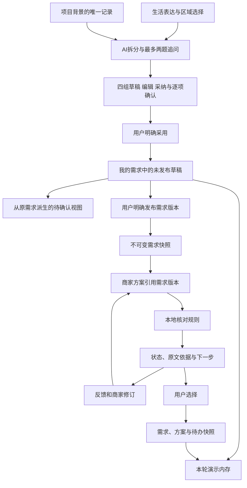

# 当前实现结构

明码包含静态前端、同源网关和独立 AI 服务。`mingma-lab` 使用 Vite、TypeScript 与 Tailwind CSS 构建澄境；`#clarify` 挂载 AI 需求获取模块，调用 `mingma-api` 的 `/api/ai/intake`。方案比对与商家修订界面仍使用本地规则和模拟公司。当前没有数据库或真实商家通信服务。

## 工程之间的关系

| 工程 | 当前作用 | 安装与启动位置 |
| --- | --- | --- |
| `mingma-lab` | 当前主工程：澄境与历史设计源码 | 在该目录执行 `npm ci`、`npm run dev` |
| `mingma-mvp` | 早期单版 MVP，保留迭代历史 | 在该目录安装；开发可使用 `npm run dev -- --port 5180` |
| `mingma-3d` | 早期 Three.js / WebGL 户型线路实验 | 在该目录安装；开发可使用 `npm run dev -- --port 5178` |
| `mingma-api` | Node.js + TypeScript + Zod 的无状态 AI 接口 | 在该目录安装、配置 `.env` 后 `npm start`；默认 5199 |

各目录是独立 npm 工程，不是 npm workspace。`mingma-lab` 构建澄境首页和旧澄境链接的跳转页。

## 主工程文件地图

| 路径（相对 `mingma-lab`） | 职责 |
| --- | --- |
| `index.html` | 澄境首页 |
| `vite.config.ts` | Tailwind 插件、相对资源路径、澄境与旧链接跳转入口 |
| `versions/<版本>/src/main.ts` | 页面模板、hash 导航、事件处理、状态与本地存储 |
| `shared/intake-ui.ts`、`intake-ui.css` | 三版共享的表达、追问、编辑、确认和导出界面 |
| `shared/intake-state.ts`、`intake-state.test.ts` | 访谈草稿、建议采纳、确认门槛、冲突与迟到响应保护 |
| `shared/intake-contract.ts` | 前后端共用的公开类型与背景条目，不包含运行时依赖或密钥 |
| `shared/requirements-hub.ts`、`requirements-hub.css`、`requirements-hub.test.ts` | 统一需求页的背景迁移、派生待办、只读历史记录及样式 |
| `versions/<版本>/src/domain.ts` | 旧厨房演示需求、方案文本规则、演示修订和 CSV 解析 |
| `versions/<版本>/src/domain.test.ts` | 该版领域规则测试 |
| `versions/<版本>/src/dimensions.ts` | 旧维度名称与商家承接引导定义，不再提供独立评分界面 |
| `versions/<版本>/src/house-data.ts` | 房间、尺寸和水电线路的演示数据 |
| `versions/<版本>/src/glass-model.ts` 或 `atelier-model.ts` | 当前使用的交互空间投影绘制 |
| `versions/<版本>/src/style.css` 及其导入样式 | 各版布局、视觉和响应式规则 |
| `public/assets/`、`public/fonts/`、`public/previews/` | 视觉素材、本地字体、实际界面截图 |
| `scripts/check.mjs` | 分别执行三版 TypeScript 检查 |
| `scripts/package-delivery.py` | 将构建产物与源码打包并输出 ZIP 校验清单 |

`<版本>` 为 `atmosphere`、`lucid` 或 `atelier`。目录中保留了早期空间渲染文件；当前实际使用的渲染器以 `main.ts` 导入为准。新需求获取逻辑共用 `shared/`；旧方案规则仍分别保存在三版目录中。

## 页面与状态

每版有七个有效页面：`#overview`、`#clarify`、`#requirements`、`#compare`、`#vendor`、`#space`、`#records`。`#requirements` 统一显示“我的需求”；旧 `#dimensions` 兼容跳转到该页，独立维度导航与评分表已撤下。页面路由不需要服务器回退；真实 AI 共创需要同源 `/api` 转发。Vite 开发服务默认代理到 5199，本机部署由 `scripts/local-web.mjs` 同时提供构建产物和 API 转发；单独解压静态 ZIP 不包含这项服务。



澄境的访谈、项目背景、商家草稿和方案版本只保留在当前页面内存中。刷新或重新打开会清空。访谈可导出 Markdown 或 JSON，项目可导出 JSON。

## 统一需求页与背景来源

“我的需求”的待确认区域直接读取当前需求：有 intake 元数据时使用 `intake.pending`，旧需求使用原 `pending`。同一需求、责任人和问题的重复记录合并展示，不复制出另一份可编辑待办，也不根据关键词自动打成熟度分。

`projectContext` 只包含使用者与生活习惯、居住安排与时间、交付与确认方式三个字段，每项有原文和用户核对状态。初次读取时，尚无新字段可从旧 O01、O08、O09 取得原文；旧确认状态只有在有原文依据时才保留。新字段一旦保存，即使后来主动清空，也不会被旧表的值重新填回。

保存的背景随 intake 请求传入，在共创中只读显示；修改只在“我的需求”进行。背景变化会撤销旧确认并要求重新整理，新的采用文档和发布快照保存所使用的背景。`confirmed` 表示用户核对信息，不是专业事实或工程认证。

商家九个维度出现在商家工作区，作为承接范围、资料、能力边界和协作条件的回应引导。用户仍在对应需求下填写商家方案，不再填一张独立评分表。旧商家记录没有绑定具体企业，历史查看与导出时保留其原身份，不自动赋给木序设计或栖居营造。

## 核对规则与数据约定

新流程的 `IntakeItem` 保存稳定编号、`scope`、多区域关联、工程类别、构件、描述、来源、必要性、清晰度、原文证据、可检查标准、待确认任务和依赖。`scope` 区分全局、区域、公共和归属待定；待确认清单是同一条目的状态视图，不重复生成施工项。

用户明确采用时，已确认条目转换成兼容现有页面的 `Requirement`，并附带 intake 元数据；完整访谈文档保留未采纳建议、暂缓和排除项。建议需显式采纳，未逐项确认、必须项冲突、必要业主决策未解决或未确认替换现有草稿时，不能采用。采用只更新未发布草稿，正式发布仍由用户在“我的需求”完成，快照同时保存当时的项目背景，旧快照保留。

首页“完整演示”仍使用原厨房 K01–K06 案例，用于查看本地商家协作闭环；它与真实 AI 访谈入口明确分开。

方案 `Proposal` 保存商家、方案版本及所引用的需求版本。每条 `ProposalItem` 用需求编号关联原文和商家的回应状态。CSV 提交字段为：

```csv
requirementId,commitment,text
K02,partial,"已预留洗碗机安装位与电源，供水和排水配套待补充。"
```

`commitment` 只接受 `yes`、`partial`、`no`、`unknown`。本地 CSV 解析器处理引号、逗号、换行与重复项目等边界，提交前仍需人工查看内容。

核对状态 `Finding.status` 有四种：

| 状态 | 含义 |
| --- | --- |
| `responded` | 当前规则所检查的文字要点已回应 |
| `partial` | 原文缺少部分说明，或商家明确表示仅部分回应 |
| `conflict` | 商家表示无法回应，或原文与明确的需求边界冲突 |
| `unknown` | 缺少资料、重复回应、尚未确定，或不在自动规则覆盖范围 |

方案比对页面的旧规则只对已知演示描述运行。AI 生成或手动编辑的需求不会自动套用旧厨房模板判为通过；超出规则范围时仍需人工核对。`responded` 也不表示现场条件已确认或施工可行。独立的 AI `review`、`explain` 接口已保留，但本轮没有替换商家页面的核对逻辑。

## 空间表达

当前主工程把三维坐标投影为 SVG，支持旋转、缩放、俯视、房间点选、墙体显示与冷水/热水/电线路径筛选。它适合展示「需求关联哪个空间和点位」，不依赖 WebGL。

五个房间、67㎡面积和路线均为演示资料。模型没有自动户型识别、真实工程设计或规范校核。商家空间资料为空时应显示资料缺口，不借用演示线路冒充其方案。

## 运行与验证边界

`npm test` 运行三版领域测试与共享 intake 状态测试；`npm run build` 检查 TypeScript 并构建所有 HTML 入口。浏览器与视觉验收单独执行，本轮整合结果见[发布验证](requirements-unification-verification.json)，前一轮需求共创结果见[历史发布验证](intake-release-verification.json)，旧记录见[历史摘要](../mingma-lab/review/verification.json)。源码中保留 Three.js 实验代码，不代表当前主页面依赖 WebGL。

AI 服务的协议见[接口契约](api/README.md)；Zod schema 同时用于校验与 OpenAPI 生成。主入口在 `mingma-api/src/server.ts`，HTTP 边界在 `app.ts`，提供商适配在 `provider.ts`；新流程定义和约束在 `intake.ts`，原四接口在 `operations.ts`。每次请求携带上下文，不将项目写入数据库。数值必须具有当前用户原文依据，既有草稿不能变成新的测量证据；现场、商家和专业待办不会因模型少返回一个字段而自动消失。

浏览器接入保留原输入、可编辑草稿与来源数组。取消、超时、页面离开和新一轮编辑会阻止过期结果覆盖当前内容，错误不会静默退回演示答案。服务没有账号、数据库或自动发送权限，返回成功不代表需求已经发布。

## 局域网访问边界

本机部署仍将 API 5199 绑定到回环地址。LAN 网关允许同一私有 IPv4 局域网中的设备直接调用同源 `POST /api/ai/intake`，无需访问码；其他 API 和诊断入口对远端仍返回 403。网关继续检查 Host 与 Origin，后端保留请求频率和并发限制；浏览器不持有 DeepSeek 密钥。
