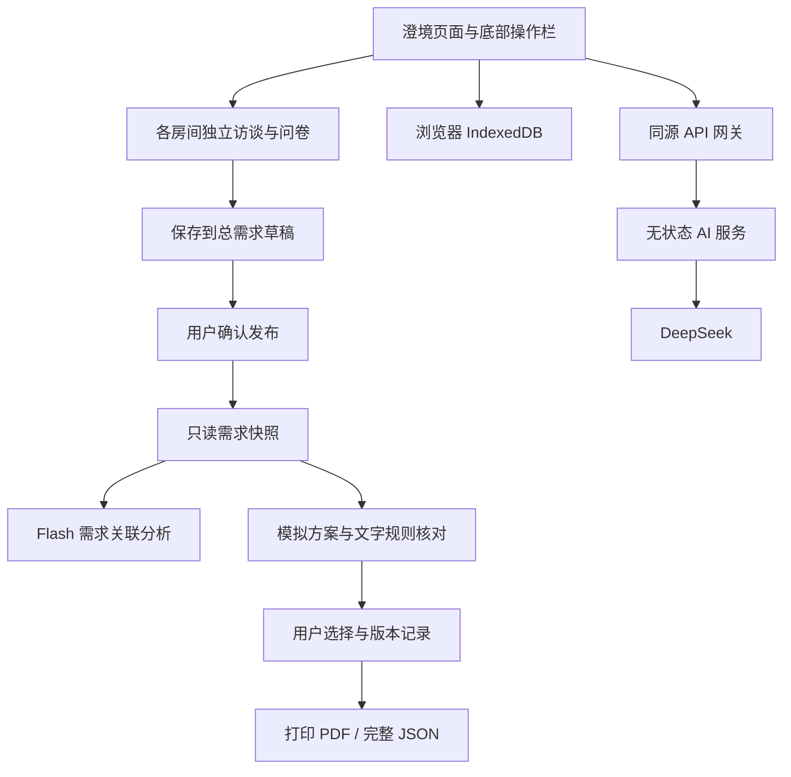

# 当前实现结构

安居有数由澄境静态前端、同源网关和无状态 AI 服务组成。项目保存于浏览器 IndexedDB，没有服务端项目数据库、真实商家身份或消息系统。

## 工程入口

| 目录 | 职责 |
| --- | --- |
| `mingma-lab` | Vite、TypeScript、Tailwind CSS 前端；Three.js 首页与独立工程预览 |
| `mingma-api` | Node.js 24、TypeScript、Zod；模型请求、输入输出校验与契约生成 |
| `scripts` | macOS 服务生命周期与静态 / API 同源网关 |
| `postman` | 请求集合和 DeepSeek 本地依赖模拟 |
| `mingma-mvp`、`mingma-3d` | 早期原型与 WebGL 实验 |

各工程独立安装依赖，不是 npm workspace。主构建入口为 `mingma-lab/index.html`，旧澄境地址保留跳转；其他设计源码仍在仓库供参考。

## 关键文件

以下路径相对 `mingma-lab/`。

| 文件或目录 | 职责 |
| --- | --- |
| `versions/lucid/src/main.ts` | 页面、hash 路由、状态编排、发布与确认入口 |
| `shared/room-work.ts` | 房间稳定 ID、独立需求编号、保存和总清单合并 |
| `shared/intake-ui.ts`、`intake-state.ts`、`intake-questionnaire.ts` | 表达、动态追问、草稿、逐项确认、问卷状态与迟到响应保护 |
| `versions/lucid/src/workflow-action.ts`、`workflow-dock.ts` | 按真实状态选择下一步、缺项定位、焦点和底栏 |
| `versions/lucid/src/project-storage.ts` | IndexedDB 保存、读取、异常与写入冲突处理 |
| `shared/project-session-validation.ts`、`planning-snapshot.ts` | 持久化记录和户型快照校验 |
| `shared/room-planning.ts`、`planning-source.ts`、`planning-floorplan.ts` | 图纸入口、房间选择和概念立体户型 |
| `shared/planning-analysis.ts`、`planning-recognized.ts`、`floorplan-contract.ts` | 图片处理、识别候选与共享契约 |
| `shared/wall-demolition.ts`、`wall-demolition-data.ts` | 墙体展开、人工性质标注与拆除意向 |
| `shared/requirements-hub.ts` | 项目背景、派生待确认、历史兼容 |
| `shared/requirement-insight-contract.ts`、`requirement-insight-request.ts` | 发布后分析协议与浏览器校验 |
| `versions/lucid/src/requirement-insight-view.ts` | 图谱、指标、原文与失败状态 |
| `shared/assessment.ts`、`assessment-ui.ts` | 风险检查、核实安排、来源变更与快照 |
| `versions/lucid/src/domain.ts`、`proposal-samples.ts` | 本地方案规则、CSV 解析和模拟商家回应 |
| `versions/lucid/src/project-space.ts`、`project-report.ts` | 当前户型与需求关联、可打印报告 |
| `versions/lucid/src/home-*.ts`、`engineering-*.ts` | 首页住宅、转场、独立六层工程示意 |

旧版 `atmosphere`、`atelier` 保留各自领域逻辑；共享共创模块服务多个版本。新增房间流程和底栏由澄境入口集成。

## 状态、保存与发布

主要路由为 `#overview`、`#planning`、`#clarify`、`#requirements`、`#compare`、`#vendor`、`#space`、`#records`，风险页为 `#assessment`；旧 `#dimensions` 转到需求页。页面按已有项目证据解锁，底栏在工作页提供统一操作位置。

每个 `roomWork` 按户型稳定 ID 保存访谈草稿、问卷进度、确认内容与已保存需求。保存房间只替换该房间条目，等待本机写入后返回房间选择。总清单使用已保存内容，进行中的修改仍留在房间草稿。全屋与公共项单独处理，旧单份项目作为“原有全屋需求”保留，不猜测拆分。见[房间状态说明](room-work.md)。

项目背景统一存于 `projectContext`，包含生活习惯、居住时间安排、交付确认方式；修改会撤销相关旧确认，下一次共创携带新背景。旧记录迁移保留有依据的内容，已主动清空的新字段不被旧值重新填回。

用户采用草稿或保存房间不会直接发布。明确发布后保留需求和背景快照，方案绑定需求版本，选定时再保存方案、评估与未决事项。Flash 分析附在对应发布快照，失败可重试，不撤销或重复发布；切换版本或项目后旧响应不能写入新状态。见[需求图谱](requirement-insight.md)。

IndexedDB 保存项目、图纸、墙体、房间访谈、商家草稿和历史。刷新同一来源可恢复；换设备、浏览器或来源不共享。读取异常不自动覆盖原记录，多页面冲突提供导出与重新读取提示。报告支持打印 PDF，完整 JSON 保存项目状态，当前没有 JSON 导入入口。见[报告导出](report-export.md)。

## AI、证据与方案核对

AI 服务主入口为 `mingma-api/src/server.ts`，HTTP 边界为 `app.ts`，提供商适配为 `provider.ts`。`intake.ts` 处理需求共创，`floorplan.ts` 处理图像与候选几何，`requirement-insight.ts` 处理发布后分析；`operations.ts` 保留原四个兼容接口。Zod 定义参与校验与 OpenAPI 生成。

模型输入携带所需上下文，服务不持久化项目。输出必须通过结构、条目和原文引用校验，数字与专业条件不能由模型随意补齐。需求关联只在两端原文有效时显示；统计由有效条目计算，表达清晰度不是施工可行性分数。取消、超时或新编辑后不接受过期响应，失败不静默退回演示结果。

商家页面仍使用本地规则与模拟公司。`Proposal` 引用需求版本，条目用 `requirementId` 对应需求，回应为 `yes`、`partial`、`no` 或 `unknown`。CSV 字段为 `requirementId,commitment,text`。核对结果区分 `responded`、`partial`、`conflict`、`unknown`，只说明文本回应情况；AI 或手工自定义需求超出规则覆盖时需人工核对。保留的 AI `review`、`explain` 接口未替代这些页面规则。

## 空间与界面边界

空间预览默认沿用当前演示或上传户型并关联房间需求。上传识别返回图像相对坐标，可校对房间与家具，但未实现完整逐点轮廓编辑、门窗编辑和真实尺寸校准。

墙体性质由用户手工标注，默认待核实；承重标注取消并禁用拆除意向，非承重仍需专业核实。拆除预览不改变原始模型，不自动写入需求。

六层工程和原房间线路为独立示意，不读取上传图纸作为工程设计，也不表示真实商家方案。首页与工程渲染处理 WebGL 降级、离屏暂停和退出清理；减少动态效果的实际浏览器验证范围以对应记录为准。底栏的缺项提示使用文字、焦点与高亮，见[操作栏说明](workflow-dock.md)。

## 运行与验证

开发服务将 `/api` 代理到本机 5199，本机部署由 `scripts/local-web.mjs` 同时提供静态产物和 API 转发。仅静态预览不包含 AI 服务。LAN 开启后只向私有 IPv4 来源开放 intake、floorplan、requirement-insight 三个同源 POST，其余 API 和诊断不向远端开放；密钥留在后端，Host、Origin、频率和并发检查仍保留。

运行命令见[部署说明](local-deployment.md)与[协作指南](../CONTRIBUTING.md)。前端测试、API / 网关测试、依赖模拟、浏览器验收和真实模型调用分别记录；历史记录入口见[文档索引](README.md)，不将过去的通过数量视为当前测试结论。
