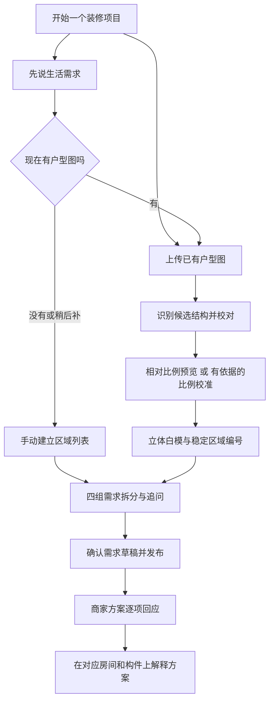

# 户型图上传与立体模型设计

本模块把用户提供的二维户型图转为可校对的空间底图和可旋转的结构白模，供用户定位需求、理解公共交界和查看方案关联。它与[需求获取与追问设计](requirements-intake-v2.md)共用区域编号、需求来源和待确认状态。

当前「空间选择」已接入真实图像识别：上传 JPG、PNG、WebP 后调用 DeepSeek Flash，输出可校对的房间多边形、墙线、门窗开口和可见家具。前端沿用 SVG 轴测风格与图纸倾斜、结构升起、房间抬升和问卷交接动画。下面的完整设计仍包含未来能力，当前交付范围以本节为准。

### 2026-11-14 已实现

- 图片最大 12 MB，浏览器压缩至最长边 2000px、JPEG，再发送同源 `/api/ai/floorplan`；服务端限制解码后 4 MiB，仅接受内联图片，不下载任意 URL，不保存图片或记录正文。
- 房间支持凹多边形。识别坐标与原图叠加使用同一映射，门窗切开墙段。图上已有的家具映射为统一示意组件，无家具图保持空家具。
- 可修改房间名称、范围、家具位置/占地/朝向，删除误识别区域或家具，手工补充矩形区域；识别可取消、失败可重试，重试失败保留已有结果。新图和离开页面会终止旧请求。
- 房间与家具均为待核对候选；图纸尺寸标注未用于米制校准，不输出真实面积、墙高或承重结论。
- 图纸和模型仅保留本轮页面，刷新清空。原图、结果不会替换首页住宅或工程分层演示；自动布置、逐点轮廓/门窗校正、模型文件导出尚未实现。
- API 定义见 `docs/api/openapi.json`；自动和浏览器检查见 `docs/floorplan-recognition-verification.json`。

## 一 在需求流程中的位置

用户可以先说需求，也可以先提供户型图。上传图纸是辅助入口，不应成为表达全局需求的前置门槛。

无图时，用户仍可建立“厨房、客厅、走道”等区域并继续访谈；后续上传图纸后，由用户将这些区域关联到识别出的房间，不要求重新回答已有问题。

已有图时，先确认大致房间与范围即可按区域访谈。比例和现场尺寸尚未确定，不影响记录“想增加洗碗机”之类的使用需求，但会影响尺寸判断与工程量展示。

## 二 首版模型的目标

首版输出结构白模，包含房间地面轮廓、墙段、门窗位置候选和房间标签。支持旋转、缩放、俯视、剖切或隐藏墙体、房间点选，以及需求与房间之间的双向定位。

墙高、墙厚和门窗立面高度在没有资料时保留为空。渲染可以使用独立的示意显示参数，但必须标明“显示高度”或“未确认”，不能写回真实尺寸字段。

首版优先支持清晰的单层 JPG、PNG、WebP 平面图。PDF 可先导出目标页为图片；多层户型、CAD 原生导入、复杂斜拍矫正、家具布置、材质效果和模型文件导出分别作为后续扩展。

不从普通户型图推定承重性质、真实层高、隐蔽管线或结构改造可行性。上传的新户型不继承当前演示模型的水电路线。

## 三 上传到模型的六步交互

| 步骤 | 用户操作 | 系统处理 | 用户看到的结果 |
| --- | --- | --- | --- |
| 1 上传与预览 | 选择图片，说明是整户图还是局部图 | 校验实际文件格式、尺寸和清晰度；显示原图 | 可以旋转、裁切或重新选择；未开始识别前保留本地预览 |
| 2 识别结构候选 | 点击识别 | 提取房间轮廓、墙段、门窗和可见文字候选 | 原图上叠加识别线条，低确定性位置单独标注 |
| 3 校对空间结构 | 重命名、合并误分区域、拖动边界、补删墙段或门窗 | 检查多边形、相邻关系和引用是否有效 | 二维叠图和房间清单同步更新；可以撤销 |
| 4 确认比例与高度状态 | 选择已知长度或暂时跳过 | 建立尺度来源；检查可用的第二条标注是否一致 | 有尺度时显示参考尺寸；未校准时仅显示相对关系 |
| 5 生成立体白模 | 确认当前结构草稿 | 按同一几何数据生成立体场景 | 可旋转、缩放、点选房间；始终可回看原图 |
| 6 关联装修需求 | 点击房间或公共交界，说明想改什么 | 将需求绑定到稳定空间编号，提出针对性问题 | 模型定位、需求列表和待确认事项联动 |

图片应优先使用正向导出的平面图。照片出现明显透视、压缩变形或标注无法辨认时，提示换用更清晰的图；允许用户继续手工描边或保留相对预览，不强行显示“识别完成”。

局部户型图只生成图中覆盖的空间。系统不得为了凑齐预设房间而补出未出现的房间。

## 四 比例与尺寸校准

### 相对预览

没有可靠尺寸时，保存图像中的相对坐标，显示房间形状与相邻关系。界面标注“未校准比例”，不显示平方米面积或米制长度。用户仍可点选区域并表达需求。

### 校准草稿

用户在原图上选取一段对应的已知长度，并输入数值、单位和来源。系统计算图像距离与实际长度的比例。长度的来源必须区分图纸标注、用户估计和现场测量；“用户确认了图纸标注”不等于已经现场复测。

图上还有其他已知尺寸时，提供第二处交叉检查。横向和纵向尺度明显不一致时，提示图片可能变形、取点错误或标注对应错误，保留相对预览，不能用一个比例掩盖失真。

经过校准，可以按当前房间轮廓计算参考面积，但名称应为“根据当前轮廓计算的参考面积”，不能标为产权面积或已经核定的工程量。只有总建筑面积时，不应直接把它当作房间净面积的校准基准。

### 墙高与厚度

实际墙高、墙厚、窗台高度等单独保存，支持“未提供、图纸标注、业主估计、现场复核”等状态。用于白模显示的默认高度和厚度只属于渲染设置；导出需求清单或给商家核对时，继续保留真实字段未知的状态。

## 五 与四组需求的关联

| 需求组 | 空间关联方式 | 点击后的交互 | 例子 |
| --- | --- | --- | --- |
| 全局硬装 | 关联整户或明确的改造范围 | 展示全局背景、受影响区域和待检查项 | 水电现状检查候选、新增设备清单 |
| 分区域需求 | 关联一个或多个稳定房间编号，可进一步关联墙面、地面等构件 | 高亮区域，并继续问目标、保留项和具体困扰 | 点击厨房，说明清洁负担和洗碗机需求 |
| 过渡与公共项 | 关联公共区域、跨区域边界或连续构件集合 | 同时高亮相关区域或交界位置 | 客厅与走道的地面交界、连续踢脚线 |
| 待确认事项 | 挂在原需求及相关空间上；归属不明时可不绑定空间 | 展示缺少的信息、责任人和确认方式 | 门洞宽度待测、管井归属待确认、是否拆改待业主决定 |

“待确认”继续作为状态，不生成重复房间或重复施工项目。同一公共交界只存一份记录，多处列表引用同一编号。

点击模型不是自动确认施工范围。用户点击厨房后说“加洗碗机”，系统记录安装意向；供水、排水和电源是待确认的配套说明，不能因此自动画出一套实际管线。

识别结果可以帮助提出问题，例如“你说的走道，是图上这段区域吗？”它不能替用户决定哪些区域必须装修。

## 六 页面结构

桌面使用“原图校对区 + 立体预览区 + 当前选中项”的工作区，重点步骤一次只突出一个主要任务。识别阶段以二维叠图为主；确认后以立体模型为主，原图可随时切回。沿用现有三版视觉语言，不新增独立的装饰性首页。

手机使用“原图、校对、立体”三个视图切换，避免并排压缩画布。底部面板显示当前房间名称、识别状态、关联需求与主操作。点选、缩放和拖动需要有明确模式，降低误拖边界的概率。

校对工具至少包括重命名房间、调整轮廓节点、补删墙段、修正门窗候选、撤销和重做。仅重命名不能替代几何校对；若首版无法支持某种结构编辑，应允许返回原图手动标注并保持“未完成校对”。

已识别、用户已校对、尺度已确认和现场已核实采用不同状态。识别置信提示只帮助安排校对顺序，不显示未经评估的“准确率 98%”。

## 七 空间数据结构

| 对象 | 必需信息 | 关键约束 |
| --- | --- | --- |
| 户型资料 | planId、版本、原图引用、图像尺寸、整户或局部覆盖、旋转裁切变换 | 原图与识别结果可追溯；替换原图不直接覆盖确认版本 |
| 尺度 | 相对坐标系、校准点、长度、单位、来源、确认状态 | 无尺度时数值为空；估计值与实测值分别标记 |
| 房间 | 稳定 roomId、名称、用途、闭合多边形、来源区域、校对状态 | 支持非矩形区域；名称不是主键 |
| 墙段 | wallId、端点、邻接房间、真实厚度及高度状态、显示参数 | 共用墙只保存一次；承重性质默认未知 |
| 门窗候选 | openingId、所属墙段、位置、类型、可选宽度与立面参数、校对状态 | 看不清时保留候选或未知，不生成确定结构 |
| 公共交界 | boundaryId、关联房间或构件、来源与确认状态 | 多区域引用同一对象，避免重复计项 |
| 需求关联 | requirementId、scope、roomIds、elementIds、planVersion、关联状态 | 全局可不绑定具体房间；不确定的关联允许空值 |
| 核实事项 | 缺口、影响对象、责任人、确认方式、完成状态 | 用户校对轮廓不自动完成现场核实 |

坐标先在图像参考系内统一保存，再按明确的转换生成三维坐标。旋转、裁切或缩放原图时，必须同步转换标注，不允许界面移动了图像而模型仍使用旧坐标。

三维模型、二维叠图和需求定位应读取同一份空间数据；不能维护三套互不一致的坐标。

## 八 模型变化与需求版本

户型模型版本与需求版本分别管理。发布需求时保存所引用的模型版本和关联关系，后续上传新图不会静默改写历史基准。

| 修改 | 需求处理方式 |
| --- | --- |
| 仅重命名房间 | 保持 roomId，更新草稿显示名称；历史快照保留当时名称 |
| 房间用途改变 | 保持空间可追踪性，同时提示复核原用途相关的需求 |
| 调整某段墙或边界 | 标记依赖这段几何的需求、尺寸和公共项需要复核；无关需求保留 |
| 一个房间拆分成两个 | 保存原房间历史，生成新空间编号；用户决定需求分别归属哪里 |
| 两个房间合并 | 提供合并后的关联候选，保留原需求与来源，用户处理重复或冲突 |
| 房间被删除或重新识别 | 原需求进入“空间关联待确认”，不能随房间一起被删除 |
| 更换整张户型图 | 生成新版模型，展示旧区域到新区域的候选映射；用户确认后才更新草稿关联 |
| 修改比例 | 重新计算参考长度和面积，将依赖旧数值的需求标准标为待复核 |

系统可提出名称或几何相近的匹配候选，但自动匹配不能替代用户对已发布需求的重新关联确认。

## 九 AI与程序的分工

AI 负责识别候选房间、图上文字、墙段和门窗，并指出看不清的位置。程序负责格式校验、几何约束、稳定编号、尺度转换、三维构建和版本关联。用户负责纠正识别、确认命名和提供可靠尺度；现场或专业人员负责确认工程事实。

几何检查至少覆盖闭合轮廓、自交、无效面积、重复墙段、越界坐标、悬空门窗和不存在的房间引用。无法通过的结果退回校对，不应静默生成看似完整的户型。

现有 SVG 三维投影中的旋转、缩放和房间点选逻辑可参考复用；当前固定视野、矩形房间和写死墙体需要改成数据驱动。Three.js 原型可复用场景与相机基础；正式几何生成需另外实现。共享空间数据也可支持 WebGL 不可用时的二维或轴测预览。

DeepSeek 当前官方文档说明 `deepseek-flash` 支持图片输入，适合作为视觉识别候选服务。但该能力本身不证明户型几何提取精度，必须用户型样本单独评估。参考：[DeepSeek Vision](https://api-docs.deepseek.com/guides/vision/)。

当前接口仅接收文本，提供商适配的消息内容也是字符串。实现时需要新增独立的图像识别请求契约，处理文件校验、图像内容输入、较大请求体、超时和几何输出校验；保留原有文本接口的限制和行为。

## 十 文件与失败处理

首版建议将单图上传上限设为 8 MiB，并在服务端解码验证格式和像素尺寸；这是产品初始限制，需在样本测试后调整。浏览器先展示文件和原图，用户点击识别时再将所选图像发送至识别服务，说明用途。

原图可能包含姓名、电话或地址，提供裁切入口。图片与模型不放进公开静态资源目录；识别日志不记录图像正文。首版可在浏览器 IndexedDB 保存原图和模型草稿，服务端仅完成本次识别；跨设备共享另行设计账号和访问权限。

| 情况 | 界面行为 |
| --- | --- |
| 图片太大或格式不支持 | 说明限制并允许重新选择，已有模型保持不变 |
| 图像模糊或不是平面图 | 指出无法确认的部分，允许换图或手工标注 |
| 识别部分成功 | 保留可校对候选，并列出缺口；不显示全部完成 |
| 模型请求失败或超时 | 保留原图与用户编辑，允许手动重试，不填入预设样板户型 |
| 用户取消识别 | 取消本次请求；晚到的结果不覆盖新的图片或编辑 |
| 再次识别同一张图 | 新结果作为候选对比，不能覆盖用户已经校对的几何 |
| 浏览器保存失败 | 明确提示未保存，支持导出结构草稿，避免误报保存成功 |
| 局域网访问 | 依照既有访问规则说明识别接口是否可用；现有仅网页共享模式不能直接调用本机模型接口 |

## 十一 完整联动示例

用户上传一张包含客厅、厨房和走道的平面图。系统识别出候选房间，用户纠正了走道边界，并提供一段图纸标注长度作为比例基准。模型显示“按图纸标注校准，未现场复测”，墙高继续显示为未知。

用户点击厨房，说“想加洗碗机，好打理”。系统将两条需求关联到厨房的稳定编号，按需求获取流程追问清洁困扰和设备情况；不会因为有了模型就直接决定设备能放下。

用户再说“客厅和走道地面想看着连贯”。系统分别记录两处区域目标，并提出公共交界候选；用户在模型上确认对应交界后，共享项同时关联两个房间，只生成一条要求。

如果用户后续调整走道边界，交界项目和依赖该尺寸的标准进入待复核；厨房洗碗机意向保留。此前发布的需求版本仍能回看原来的模型与关联关系。

## 十二 首版验收

1. 上传两张结构不同的户型图，确认结果来源于各自图像，不复用固定五房间数据。
2. 没有可靠尺度时仍能查看相对模型，页面不显示未经确认的米制尺寸或平方米面积。
3. 校准一段已知长度后，对合成基准图检查尺度转换；第二处尺寸矛盾时显示问题。
4. 调整二维轮廓后，立体模型同步改变；撤销后恢复对应几何。
5. 房间重命名后需求关联不丢失；拆分、合并或删除时要求处理关联。
6. 点击房间能查看与补充该区域需求，点击需求能定位对应空间。
7. 公共交界被多个区域引用时，仍只有一个项目编号。
8. 识别失败、取消或重试不覆盖已校对的模型，也不替换为演示户型。
9. 新上传模型不显示旧演示户型的水电线路或自动承重结论。
10. 模型更新不改写已发布需求与方案的历史引用。
11. 手机和桌面均可完成上传、校对、点选和查看；WebGL 不可用时提供清晰的降级视图。
12. 分开记录图像识别误差、几何生成正确性和需求关联正确性；不以少量成功样例宣称整体识别准确率。

实现顺序建议为：先完成统一空间数据与手工校对白模，再接入图片识别候选，随后接入四组需求联动。这样识别不理想时用户仍能完成校对，需求流程也不依赖识别一次成功。
