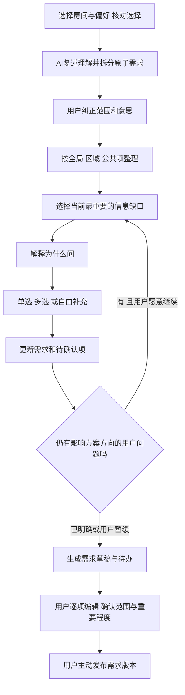

# 明码需求获取与追问设计

本设计将用户的生活偏好整理为可追溯、可修改、可由商家逐项回应的硬装需求。当前澄境入口采用“选房间与偏好、核对选择、AI 拆分与补充、最后确认”的流程，旧设计入口保留自由表达。核心产出是需求草稿、待决问题和现场核实清单。选择题改造的验证见[房间偏好验证记录](intake-preferences-verification.json)。

第二版核心流程已接入三套网页的需求共创页面：调用真实 AI 进行拆分与追问，支持四组草稿、手动编辑、建议采纳、逐项确认、导出和显式采用。正式发布在统一的“我的需求”页完成，旧快照保留。本页将当前需求、派生待确认、项目背景和只读历史记录集中维护；原独立需求维度导航与评分表撤下，旧链接兼容跳转。本轮整合结果见[整合验证记录](requirements-unification-verification.json)，前一轮结果保留在[需求共创验证记录](intake-release-verification.json)。本文同时保留交互约束和后续空间联动设计。

## 一 用户看到的四组内容

| 分组 | 收集什么 | 典型内容 | 获取方式 |
| --- | --- | --- | --- |
| 全局硬装与基础条件 | 跨房间的系统、保留边界、使用与改造约束 | 水电现状、设备使用、全屋保留项、施工期间居住情况 | 先听用户关切，再用少量基础问题补齐；专业现状交现场核实 |
| 分区域具体需求 | 用户重点关注的空间、构件和使用目标 | 客厅地面、厨房墙面、卧室收纳、卫生间使用体验 | 先选区域，再表达不便、目标与保留项，逐项深入 |
| 过渡与公共项 | 区域之间或全屋连续项目 | 过门石、门洞收口、公共走道、管井包封、连续踢脚线 | 根据涉及区域和相邻关系提出关联问题，由用户确认是否纳入 |
| 待确认清单 | 尚未决定、缺少资料或需要现场核实的内容 | 归属待定、是否必做、业主取舍、尺寸待测、商家待说明 | 自动汇总，同时保留与原需求的关联 |

四组是阅读入口。底层将范围和状态分别保存：一条厨房需求可以同时出现在“分区域需求”和“待确认清单”中，使用同一编号，不复制成两条施工项目。

“强诉求”记录用户主动强调的程度，“弱诉求”记录尚未展开的内容。是否必须由用户明确选择；系统提出的基础检查或配套建议保留“建议待确认”来源。

工程类别、构件和材料也分别记录。例如“厨房墙面贴瓷砖”可包含区域“厨房”、构件“墙面”、工程类别“泥瓦与饰面”、材料“瓷砖”。墙面、地面、吊顶本身不能统一视为木作；工种归属不确定时让商家补充。

## 二 完整获取流程

### 步骤一 选择房间与生活偏好

2026-11-15 起，当前澄境入口先显示当前户型的房间与“全屋与公共需求”，每间独立保存。进入后每次呈现一道单选、多选或 1–5 级偏好题，包含改善目标、使用者、改动程度、保留意向；只有选择相关目标时才展开地面脚感、清洁、防滑、干湿分离、厨房设备或安静程度。进度条按当前适用题目的已填数量更新，支持上一步、摘要修改、刷新恢复及“暂不确定”。

房间名称决定基础题型，上传图纸中识别到的家具成为保留项候选，并提示人工核对；演示家具不会被当作用户家的事实。1–5 级必须带含义，例如地面脚感的 1 为偏柔软、5 为偏硬实，不代表材料硬度、质量评分或工程性能。

作答完成后先核对摘要，再将选项和简短补充转换为现有 `brief`，调用原有 AI 整理接口。未显示的分支答案不发送，未知项保留未知，旧版长文本只读保留，可用勾选决定本轮是否继续引用。旧设计版本仍可使用自由表达入口。项目背景和发布确认规则不变。

### 步骤二 复述并拆分

AI 先用简短自然语言回应：“我理解你最在意厨房清洁和洗碗机，希望客厅到走道视觉连贯；水电方面想先明确需要检查什么。”随后显示可编辑的需求片段，让用户确认或纠正。

| 原始表达 | 拆分结果 | 初始状态 |
| --- | --- | --- |
| 厨房好打理 | 厨房清洁负担与维护偏好 | 目标明确，具体含义待问 |
| 洗碗机要有 | 厨房洗碗机使用需求 | 用户明确提出；型号、位置和配套待确认 |
| 客厅和走道地面连贯 | 客厅地面目标、走道地面目标、两处衔接要求 | “连贯”的含义待问；公共项候选待确认 |
| 水电不懂，希望省心 | 全局用电用水关注点及现状检查需求候选 | 现象、范围和检查方式待确认 |

一条需求尽量只表达一个可独立回应的目标或决策。共同背景可以复用。用户明确的原话和 AI 推导的关联项要分别标注；关联建议得到用户确认后才进入确定范围。

### 步骤三 先澄清含义 再给选择

“先对话”表示 AI 先回应用户意图并说明疑问，不要求额外增加一轮“你同意吗”。含义足够清楚时，可以在同一次回复中给出选择题。

每次聚焦一个问题，必要时同屏显示第二个紧密相关的问题。每题包含：对应需求、为什么要问、答案入口和“暂不确定”。可以并存的答案使用多选；相互排斥的方案使用单选。当前澄境问卷只提供选择题；旧设计入口仍可自由补充。

例如：“你提到厨房要好打理。你现在最烦的清洁问题是什么？”提供“油污难擦、接缝积灰、开放格积灰、台面东西太多、暂不确定”，允许多选和补充。选择“接缝积灰”后，再追问涉及墙面、台面还是地面，避免直接跳到某种材料。

### 步骤四 将偏好转为可回应要求

先补齐目标和范围，再收集可表达的数量、使用条件和保留边界。AI 返回的草稿应让用户看懂，也应让商家知道需要回应哪些内容。

“容易打理”可以转成：“厨房墙面与台面优先易擦拭、减少积灰接缝；商家说明材料选择、接缝处理、日常清洁和维护方式。”这是一条可回应要求，尚不构成技术数值或已确认材料选择。

### 步骤五 补充全局与公共项

用户关注的区域需求处理后，检查关联范围。例如新增洗碗机后，提示需要商家分别说明安装位、供水、排水和电源；连续地面意向涉及相邻空间时，提示是否同时考虑门洞收口与踢脚线衔接。

基础检查只按已知改造范围触发。对于用户尚未了解的水电现状，先问可观察的使用问题和设备计划；线路规格、承载能力、漏水原因等进入专业核实，不由 AI 替用户选定整改做法。

### 步骤六 核对并生成草稿

展示四组内容，区分用户明确要求、用户确认采纳的建议、尚待采纳的建议和待决问题。用户可修改重要程度、调整归属、补充说明、排除本次范围或暂缓决策。

生成草稿和正式发布是两个动作。已发布的 R1 不因一次新对话而改变；采纳新需求时形成新的草稿，用户发布后成为 R2。

### 项目背景只维护一次

使用者与生活习惯、居住安排与时间、交付与确认方式放在“我的需求”的项目背景中，支持保存原文和明确核对。保存后自动随下一次 intake 请求传入，需求共创只读展示；用户需要修改时回到同一入口。背景变化会使旧确认失效，提示重新整理，发布时保存对应快照。

旧 O01、O08、O09 的原文只在新背景字段尚不存在时带入；新字段包括空值在内均优先。其余旧维度记录保留为只读历史并可导出，不要求再填 0–3 分，也不参与新的“完成”判断。商家九维移到商家工作区作为回应提示，旧记录不会被当作某一家企业已经确认的事实。

## 三 一条需求的拆分维度

| 维度 | 值或内容 | 谁来确定 |
| --- | --- | --- |
| 稳定编号 | 如 N001；后续整理保持既有编号 | AI 提出或界面生成，程序校验并维护关联 |
| 原始表达与来源 | 原话、对应回答、引用位置 | 程序保存，AI 引用 |
| 作用范围 | 全局、具体区域、跨区域公共、归属待定 | AI 建议，用户可纠正 |
| 关联区域 | 一个或多个区域 | 用户确认；未知时不猜测位置 |
| 工程类别 | 拆改、水电、防水、泥瓦、木作、涂饰、安装等 | 初步分类，必要时商家修正 |
| 构件与材料 | 墙面、地面、吊顶、门洞等；材料另设字段 | 用户表达或后续方案说明 |
| 使用场景与目标 | 谁使用、怎么使用、希望解决什么 | 用户回答 |
| 保留项与排除项 | 保留哪些现状、本次不做什么 | 用户确认 |
| 表达程度 | 主动强调、一般提及、尚未展开 | AI 提议；不替代优先级 |
| 必要性 | 必须、偏好、可选、不做、待定 | 用户决定 |
| 可检查条件 | 数量、范围、功能覆盖、尺寸或性能目标 | 按证据和确认权限分别处理 |
| 待确认事项 | 缺什么、谁确认、何时确认、确认方式 | 程序结构化保存 |
| 关联与依赖 | 同一公共项、前置条件、冲突项、替代方案 | AI 提示，用户与商家确认 |
| 决策状态 | 待澄清、待选择、待现场核实、待商家说明、已确认、暂缓、排除 | 由具体操作和证据驱动 |

状态需要区分“用户希望怎样”和“现场能否做到”。用户确认了洗碗机需求，不等于尺寸和接口已经核实。

## 四 量化标准的表达

“量化”包含可计数、可定位、可判断是否覆盖的要求。具体施工数值只在有用户输入、测量记录或可核实专业依据时记录。

| 标准类型 | 示例 | 输出规则 |
| --- | --- | --- |
| 数量与使用容量 | 用户明确回答常用三台台面电器 | 记录设备清单与“三台”的原文来源；插座及回路方案由商家说明 |
| 空间与施工范围 | 仅处理厨房墙面，保留现有窗 | 明确区域、构件、包含项与排除项 |
| 功能覆盖 | 洗碗机的安装位、供水、排水、电源四项分别回应 | 对每个要点保留回应位置，未说明的项保持待补充 |
| 体验与取舍 | 优先减少接缝，接受商家解释维护差异 | 转成方案回应条件，由用户比较取舍 |
| 实测尺寸 | 门洞宽度、房间面积、地面现状高差 | 无实测值时 value=null，记录单位、测量对象、责任人和确认方式 |
| 专业性能或规范要求 | 涉及具体材料性能、线路规格或施工验收依据 | 保留待专业确认；引用可核实资料后才能形成技术判定条件 |

每条标准包含：指标名称、目标值或范围、单位、来源、确认状态、验证方式。目标值可以为空。即使用户给出了估计值，也要标为“业主估计，待复测”，不能自动成为已验证工程量。

界面避免只显示“量化完成”。分别显示“使用要求已明确”“数值待测”“专业条件待确认”，让用户知道目前可以决定什么。

## 五 后续追问的选择规则

AI 每次根据当前信息生成候选问题；程序检查题目是否有效、是否重复以及是否越过确认权限。

### 优先顺序

1. **影响本次方向的冲突或范围不明。** 例如“完全不拆”和“全部更换地面”同时作为必须项时，先请用户说明保留边界和取舍。
2. **用户主动强调的具体困扰。** 让用户先看到系统理解了最关心的事。
3. **影响多个需求的全局条件。** 例如本次涉及哪些区域、是否带住改造、哪些现状必须保留。
4. **当前需求的关键使用条件和依赖。** 例如增加设备后补问已有型号与使用位置，再记录现场接口待查。
5. **跨区域公共项。** 已确认涉及相邻区域时，再问连续段和收口范围。
6. **不会改变大方向的表达与细节。** 材料外观等可后置；用户主动强调时可提前。

这是一组排序规则，不是固定问卷。每次回答后重新检查信息缺口，已经回答、用户已排除或明确暂缓的内容不重复询问。需要测量、商家资料或专业意见的问题直接进入相应待办，避免反复要求业主猜答案。

### 分组追问示例

| 当前线索 | 先澄清什么 | 选择或补充方式 | 下一步 |
| --- | --- | --- | --- |
| 全屋水电想省心 | 当前是否有具体使用不便或已知问题 | 多选可观察现象、设备计划、暂不确定；自由补充 | 生成检查与配套说明候选；现状和技术做法待专业确认 |
| 卧室墙面想处理 | 主要想改变什么，哪些部分需要保留 | 多选外观、已有破损、易清洁、暂不确定 | 按选中的目标继续问范围；病害原因不直接下结论 |
| 客厅地面想统一 | “统一”指什么 | 多选颜色、材质、规格、衔接视觉、暂不确定 | 区分各区域目标与公共衔接要求 |
| 不想拆太多 | 哪些部位最希望保留，哪些改动可讨论 | 区域或构件多选；对具体保留/更换用单选 | 固定边界，再处理与其他目标的冲突 |
| 踢脚线希望连贯 | 涉及哪些连续区域，是否接受交界处理 | 区域多选；做法未知时让商家提供替代 | 只建一个共享项目，关联多个区域 |
| 管井包封不清楚 | 所在区域和当前关注点是什么 | 选区域或归属待定；支持补照片作为后续资料 | 必要性、检修和具体做法待商家及现场说明 |
| 这个不知道要不要做 | 什么条件会影响决定 | 单选必须、偏好、待看方案、暂不做；允许解释 | 记录决策条件与责任人，保留待决状态 |

每题保存 `targetRequirementId`、`dimension`、`reason`、`answerType`、`options` 和原始回答。程序用“需求编号 + 维度”识别重复；同维度出现新矛盾或用户主动改口时，可以发起一次带原因的再次确认。

## 六 公共项和待确认项的处理

公共走道既可以有自己的区域需求，也可以承载与相邻房间相关的公共项目。通过实际服务范围决定归属，不能把所有走道工作统一归为“公共项”。

例如客厅和走道要保持视觉连贯：各自的地面目标仍属于区域需求；两者交界处理建立一个共享项目 S001，关联两处区域。两张区域清单都引用 S001，汇总和后续商家回应只计一项。改变 S001 后，两处引用同步反映同一版本。

待确认事项不是垃圾分类。每条必须说明：缺少什么、影响哪条需求、谁负责确认、需要什么资料、影响哪一步。允许的责任人包括业主、商家、现场测量人员和专业人员。未知的责任人本身也要保留为待分配状态。

## 七 停止追问与发布条件

**可以生成草稿：** 已能说明本次大致范围和主要目标；每条已知需求可归入具体范围或明确标为归属待定；剩余缺口已进入待办。用户也可主动选择“先看草稿”，无需完成固定轮数。

**允许继续追问：** 用户还愿意回答，且新问题会影响范围、目标、保留项、必要性或方案方向。界面给出“为什么还要问”，并提供暂缓入口。

**可以发布协作基准：** 用户已经查看草稿、确认确定范围和重要程度，且不存在被同时确认成必须项的直接冲突。尺寸或现场条件可随待办发布，但应标明方案需在这些条件核实后才能继续确认。

**冲突尚未解决时：** 两种相反的做法保留为待决选项，不同时列为必须项。可发布用户明确确认的其余范围，并明确这些待决内容不构成商家必须执行的承诺。若冲突使整项改造范围都无法确定，则先保留草稿。

每个维度显示“已明确、待业主选择、待现场核实、待商家说明、已暂缓或不适用”。进度显示实际数量，避免让“答了几题”冒充需求已经完整。

## 八 页面组织

桌面沿用现有三版视觉风格：共创页面承载当前对话、复述和问题，旁侧显示四组摘要；“我的需求”作为确认与发布的统一入口，清单是主体，待确认信息直接从这些需求派生，项目背景和旧记录折叠展示。用户点击缺口可以定位原需求，不必去另一张表重复填写。

手机先显示当前问题和主操作，摘要折叠为“已整理几项、待确认几项”的入口。用户完成本题后再展开下一题，避免长表单。单选、复选和自由输入都使用可键盘操作的原生控件。

主要操作依阶段变化：开始梳理、补充或纠正、确认本题、暂时跳过、先看草稿、逐项确认、发布需求。每次提交保留原回答；返回上一题修改后，仅重算受影响的草稿项和后续问题，不覆盖已发布版本。

加载中显示本次正在分析的任务并允许取消；失败保留输入和原草稿，提供重试。服务不可用或局域网尚未开放 AI 时说明原因，不能悄悄切换演示数据并声称 AI 已完成。

## 九 完整对话示例

以下选择仅用于说明设计行为，不代表系统应默认替用户选择。

**用户：** 厨房想好打理，加洗碗机；客厅和走道的地面看着统一，水电我不太懂。

**AI 复述：** 我先记录厨房清洁、洗碗机、客厅与走道地面三个重点。水电先作为全局待检查项；地面交界是否一起处理，稍后再请你确认。

**AI 追问一：** 你说“好打理”，最想减少哪些麻烦？可多选：油污难擦、接缝积灰、开放格积灰、台面杂物、暂不确定。

**用户：** 油污和接缝，主要是墙面和台面。

**更新：** 厨房墙面、台面的易清洁目标已明确。材料和接缝做法由商家说明；本轮没有生成默认材料型号。

**AI 追问二：** 洗碗机型号选好了吗？单选：已选好、还没选、暂不确定。选择已选好时再补充型号或规格资料。

**用户：** 还没选，准备在水槽旁边放。

**更新：** 希望新增洗碗机，偏好靠近水槽。安装尺寸、接口与位置可行性待核实；供水、排水和电源作为建议配套项等待用户采纳和商家说明。

**AI 追问三：** 客厅到走道“看着统一”，你指哪些方面？可多选：颜色接近、相同材料、相同规格、交界自然、暂不确定。

**用户：** 颜色接近，交界自然。材料可以不同。

**更新：** 两处区域分别记录地面视觉目标；提示一个公共项候选“客厅与走道交界处理”，不默认要求同材同规格，也不默认拆除原有过门石。

**AI 追问四：** 交界和踢脚线是否一起纳入这次方案？可多选：门洞收口、交界段、连续踢脚线、暂不确定；另提供“先让商家解释必要性”。

**用户：** 交界段必须考虑；踢脚线先看商家方案。

**更新：** 共享交界项纳入已确认范围；踢脚线作为业主待决项，不计为已经确认的必须项。

**AI 追问五：** 水电方面，目前有哪些使用不便，或这次会新增哪些设备？可多选、自由补充，支持“不清楚，先现场检查”。

**用户：** 主要新增洗碗机，其他不清楚，先检查。

**草稿结果：** 生成厨房清洁目标、洗碗机使用需求、客厅地面目标、走道地面目标和一个共享交界项；全局检查作为已采纳的检查范围；另列设备尺寸、接口、现状高差与踢脚线决策等待办。最终发布前再由用户确认每项重要程度。

## 十 当前实现与衔接

三套网页的 `#clarify` 已统一使用 `mingma-lab/shared/intake-ui.ts` 与 `intake-state.ts`，调用新增的 `POST /api/ai/intake`。原有 `clarify`、`requirements`、`review`、`explain` 接口保持兼容。完整字段见[接口契约](api/README.md)，公开类型在 `mingma-lab/shared/intake-contract.ts`，服务端约束在 `mingma-api/src/intake.ts`。

1. **统一需求结构。** 条目包含作用范围、多区域、构件、必要性、来源、证据、标准、待办和依赖；程序检查编号与引用。数值需要当前用户原文依据，前次草稿不作为新的测量证据。
2. **统一追问状态。** 每批最多两题，界面逐题呈现；完成本批或主动重新整理后再请求。程序过滤已答、暂缓或重复维度，保留现场、商家和专业待办。用户可以先看已有草稿，也可以修改回答后重新分析。
3. **统一草稿确认。** 四组视图引用同一条目。用户可编辑名称、描述、归属、区域、工程、构件和必要性；标准与责任人以明确状态展示。建议须主动采纳，拟纳入条目须逐项确认，必须项冲突需先处理。修改描述会将旧数值标准重新标为待确认。
4. **明确采用与发布。** 用户确认替换当前草稿后才能采用；采用不会发布版本。在“我的需求”主动发布时保存当时的背景与需求快照。待决、不做和未采纳项仍保留在完整访谈文档中，已发布快照不受影响。访谈状态按三版分别保存，支持 Markdown 与 JSON 导出。
5. **统一背景与协作入口。** “我的需求”保存三项项目背景，待确认视图从原需求派生。背景变化会提示重新梳理并撤销旧确认；旧维度记录只读保留。商家九维仅在商家工作区提供承接回应引导，不把旧无企业归属的记录绑定到模拟公司。

旧项目与旧访谈数据不自动补造归属或数值。模型失败、取消或迟到响应不会覆盖最新编辑，也不会切换成演示答案。商家页面当前仍用旧本地规则；AI 草稿不会因为沿用某个编号就被旧模板自动判为通过。

户型图上传和立体模型作为可选的空间资料入口，详见[户型图上传与立体模型设计](floorplan-model-design.md)。有图时，通过用户校对后的房间编号定位需求；无图时，使用手动区域列表。模型版本、需求版本分别保存，公共项使用多区域或交界关联；模型识别结果不直接成为用户需求或已确认工程事实。

## 十一 验收用例

| 输入或操作 | 期望结果 |
| --- | --- |
| 只说“厨房好打理” | 先询问清洁含义和构件范围，不直接生成某材料的采购要求 |
| 说“不懂水电” | 询问使用现象与新增设备，专业参数进入现场或商家待办 |
| 没有主动提水电 | 可以提出范围相关的基础检查建议，不能把“未提及”视为“不需要” |
| 客厅与走道地面连贯 | 区域目标与公共交界项分开，共享项只生成一次 |
| 同一需求的归属待定 | 暂存待确认，同时保留目标与来源，不丢弃或强行指定房间 |
| 用户未给出尺寸 | 标准中保留指标和单位，数值为空并指定确认方式 |
| 用户给出估算尺寸 | 标记为估计与待复测，不能显示为已确认现场事实 |
| AI 提出新增配套 | 保留建议来源，用户采纳前不成为已确认必须项 |
| 用户选择暂不确定 | 保存这一回答并进入待办，不把它作为设备或材料名称 |
| 已答问题再次进入候选 | 程序去重；有新冲突才允许说明原因后再次确认 |
| 用户修改原回答 | 更新受影响草稿与依赖项，已发布版本保持不变 |
| 相反做法同时为必须项 | 阻止冲突进入同一正式基准，提示选择或标为待决 |
| 用户中途先看草稿 | 可以查看并编辑已有内容，未知项和建议仍清晰可见 |
| 仅剩现场测量问题 | 停止向业主追问专业数值，生成现场核实清单 |
| 模型出错或超时 | 保留当前输入和草稿，显示失败与重试入口，不自动填入演示答案 |

### 统一入口的补充验收

| 操作 | 期望结果 |
| --- | --- |
| 打开原 `#dimensions` 链接 | 进入“我的需求”，导航不再有独立维度入口 |
| 查看清单中的待确认项 | 直接引用当前需求，可定位原条目，不生成第二份待办 |
| 从旧 O01、O08、O09 取得背景 | 保留原文与有依据的核对状态，原始记录仍可只读导出 |
| 保存背景后主动清空字段并刷新 | 保持空值，旧量表内容不再复活 |
| 修改背景后继续 AI 共创 | 新背景进入请求，旧确认失效，不能沿用旧模型结果直接采用 |
| 发布包含背景的需求版本后再次修改 | 新背景只影响当前草稿，已发布快照不变 |
| 查看旧商家维度记录 | 不自动归属任何一家模拟企业，不视为其方案承诺 |

## 首轮选择题的进一步深挖（2026-11-15）

选择偏好现分为“生活与现状、功能细节、取舍与保留”三组，分组展示已答数量，并可定位到该组未完成的第一题。生活方式与实际不便由用户主动选择，不从户型推断；功能题按改善目标及前级答案继续展开。例如收纳继续区分物品、现有困难、取放方式，衣物或电器再有独立追问；厨房设备区分洗碗机与蒸烤用途；较重视清洁时问希望减少什么维护；家人需要夜间便利时才问照明操作。

尾部询问保留程度、优先解决的目标与不能接受的取舍。取消某个目标或上级选项后，其分支从当前题数、摘要与 AI 输入移除，保存的答案供再次选回时恢复；原先最高优先级已不在当前目标时，要求重新选择。不同房间完整展开的测试路径为 24–30 题，实际题数依答案而定。房间偏好题提供短输入框，留空点下一题记为待确认。等级只表示主观偏好。旧版 4–8 题草稿按题目 ID 恢复原位置，新加入的题目保留未答状态，不自动补答案。

## 作答方式（2026-11-15）

每道房间偏好题底部可选填一句补充，与勾选答案一起保存。补充也可单独作答并计入进度。原“自由补充”、手写业主决定和问卷内文本编辑已移除。AI 选项会保证有“暂不确定”和“以上选项都不适合”，选择这两项记录为暂缓，不当作确定需求；不会发送隐藏的旧自由补充内容作为新的回答。历史回答只读展示，当前批次可重新选择；旧文字记录可选择是否继续引用，原文仍保留。未解决的业主决定仍阻止确认，用户可继续选择题或暂不纳入，不能因为没有简答框就自动通过。
